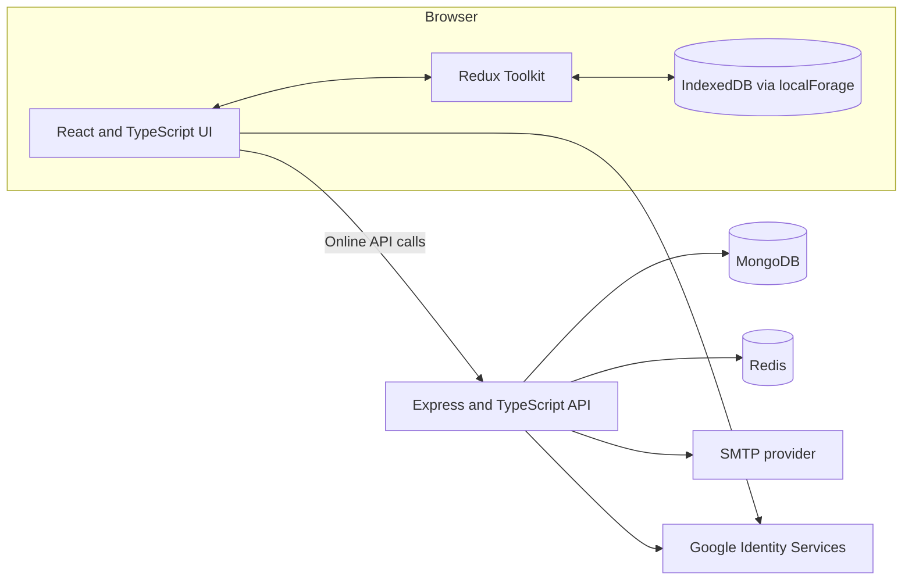

# BudgetBox

**A personal budgeting app that keeps working offline.**

[](https://github.com/NOBISSS/BudgetBox/actions/workflows/ci.yml)

BudgetBox helps people record monthly income and expenses, understand their spending, and keep their budgets available when the network is unreliable. The browser saves each edit to IndexedDB first. When the device is online, a separate API syncs pending changes across devices.

This repository contains a React single-page app, a Node.js API, local development services, tests, and deployment guides. The frontend is deployed separately from the API; MongoDB and Redis are separate services.

## What you can do

- Create monthly budgets with income, bills, food, transport, subscriptions, and miscellaneous expenses.
- Review dashboard totals, savings, history, charts, and rule-based spending insights.
- Create recurring payments with daily, weekly, monthly, quarterly, yearly, or one-time schedules; mark individual occurrences paid.
- Keep viewing and editing saved budgets offline, including after reloading the app.
- Sync budget records and recurring schedules between devices when online.
- See whether a budget is local, pending sync, or synced. If two devices edit the same month, the later `updatedAt` timestamp wins and the server returns its authoritative record.
- Register and sign in with email/password or Google, reset and change a password, and sign out.
- Configure an email provider for welcome and password-reset messages.

### Offline behavior

Budget edits are saved to the current browser's IndexedDB before the interface updates. Existing local budgets and dashboard calculations remain available offline; queued changes sync after connectivity returns. The app shell must have loaded online at least once for offline page loading to work.

Password accounts can unlock that device's saved data after signing out by entering the same email and password. This verifies a salted password verifier stored locally; it does **not** create an API session. Reconnect and sign in online to sync. Google-only accounts need internet to authenticate again after logout. Clearing local data removes the local budgets and offline unlock information.

Month-end estimates are forecasts, not bank transactions. They treat bills and subscriptions as fixed amounts, add scheduled unpaid occurrences, then project the daily pace of variable spending. The app does not connect to a bank feed or automatically know when a payment happened: record spending and mark recurring occurrences paid to keep the estimate useful.

## How it works



The browser owns the immediate editing experience. The API authenticates requests, validates data, scopes records to the signed-in user, and synchronizes changes. MongoDB stores user and budget records. Redis supports rate limits, token revocation, password reset, and short-lived response caches. Insights are calculated from local budget data so they remain available offline.

## Technology

| Part | Stack |
| --- | --- |
| Frontend | React 18, TypeScript, Vite, React Router, Redux Toolkit, Tailwind CSS |
| Local persistence | IndexedDB through localForage |
| Backend | Node.js 20, Express, TypeScript, Zod, Mongoose |
| Data and cache | MongoDB 7, Redis 7, ioredis |
| Authentication | JWT, bcrypt, Google authorization-code flow |
| Email | Nodemailer over SMTP |
| Tests | Vitest, Supertest, MongoDB Memory Server, Redis mock |
| Deployment | Vercel frontend, Docker-ready API |

## Run locally

### Requirements

- Node.js **20.x** and npm
- Docker Desktop or Docker Engine with the Compose plugin
- Git

### 1. Get the code and configure local environment files

```sh
git clone https://github.com/NOBISSS/BudgetBox.git
cd BudgetBox
```

Create local environment files from the examples. PowerShell:

```powershell
Copy-Item backend/.env.example backend/.env
Copy-Item frontend/.env.example frontend/.env
```

macOS/Linux:

```sh
cp backend/.env.example backend/.env
cp frontend/.env.example frontend/.env
```

The examples point to local MongoDB, Redis, and the local Vite app. Set `VITE_API_URL=http://localhost:5000/api` in `frontend/.env`. Google sign-in is optional; set `VITE_GOOGLE_CLIENT_ID` in the frontend and the matching `GOOGLE_CLIENT_ID` plus `GOOGLE_CLIENT_SECRET` in the backend. Leave both backend Google values empty to disable it. Never put the Google client secret in a `VITE_` variable.

Email is optional for local development. Without SMTP settings, password-reset links and welcome email previews are written to the backend console. To send actual email, configure all SMTP variables in `backend/.env`.

### 2. Start MongoDB and Redis

From the repository root:

```sh
docker compose up -d
```

Check service status with `docker compose ps`. MongoDB and Redis data are stored in named volumes and remain after stopping containers. Stop the services with `docker compose down`.

### 3. Install dependencies and start the API

In terminal one:

```sh
cd backend
npm ci
npm run dev
```

The API listens at `http://localhost:5000`. Check readiness at [`http://localhost:5000/api/health`](http://localhost:5000/api/health); a ready response reports MongoDB and Redis as up.

Optional: create a local demo account and three sample months:

```sh
npm run seed
```

The development seed credentials are `demo@budgetbox.app` / `Demo@12345`. The seed does not overwrite an existing account password or existing month records. Use this account only with local development data.

### 4. Start the frontend

In terminal two, from the repository root:

```sh
cd frontend
npm ci
npm run dev
```

Open the Vite URL printed in the terminal (normally [`http://localhost:5173`](http://localhost:5173)). Register a user or use the local demo account. The frontend calls the API at `VITE_API_URL`.

## Commands

Run commands from the matching `frontend/` or `backend/` directory.

| Command | What it does |
| --- | --- |
| `npm run dev` | Start the development server (frontend or API) |
| `npm run build` | Type-check and create a production build |
| `npm test` | Run the Vitest suite |
| `npm run lint` *(backend)* | Run the backend TypeScript check |
| `npm run seed` *(backend)* | Create local demo data |
| `npm run format` *(backend)* | Format backend TypeScript, tests, and JSON files with Prettier |

Backend integration tests use MongoDB Memory Server and may download a MongoDB binary on the first run. CI runs install, build, and tests for both apps, then builds the backend Docker image. Run the suites with:

```sh
cd frontend && npm ci && npm run build && npm test
cd ../backend && npm ci && npm run build && npm test
```

## API overview

All endpoints use the `/api` prefix. Protected routes require `Authorization: Bearer <token>`. Responses use `{ "success": true, "data": ... }`; errors use `{ "success": false, "error": ... }`.

| Endpoint | Purpose |
| --- | --- |
| `GET /api/health` | API and dependency readiness |
| `POST /api/auth/register` | Register with email and password |
| `POST /api/auth/login` | Sign in with email and password |
| `POST /api/auth/google` | Exchange a Google authorization code |
| `GET /api/auth/me` | Get the current account |
| `POST /api/auth/logout` | Revoke the current token |
| `POST /api/auth/forgot-password` | Request a password reset email |
| `POST /api/auth/reset-password` | Set a new password using a reset token |
| `POST /api/auth/change-password` | Change password for the signed-in account |
| `POST /api/budget/sync` | Push monthly budget records |
| `GET /api/budget/latest` | Read the latest non-deleted budget |
| `GET /api/budget/history?year=2026` | Read budget history |
| `GET /api/budget/changes?since=<ISO timestamp>` | Pull budget changes and tombstones |
| `POST /api/budget/recurring/sync` | Push recurring payment schedules |
| `GET /api/budget/recurring/changes?since=<ISO timestamp>` | Pull recurring schedule changes |

See [API documentation](./docs/API.md) for payloads, examples, and sync details.

## Project layout

```text
BudgetBox/
├── frontend/                 # React app, offline storage, UI, and frontend tests
├── backend/                  # Express API, MongoDB models, services, and tests
├── docs/
│   ├── API.md                # API request/response details
│   ├── FRONTEND_AUDIT.md     # Frontend implementation audit
│   ├── PROJECT_REPORT.md     # Detailed project/assignment report
│   └── PROGRESS.md           # Project phase checklist
├── .github/workflows/ci.yml # Frontend/backend CI and Docker build
└── docker-compose.yml        # Local MongoDB and Redis
```

## Deploy

The frontend is a Vite app configured for Vercel, including SPA route rewrites, security headers, offline app-shell support, and generated Open Graph metadata, `robots.txt`, and sitemap. The API can run as a Node 20 service or in the included multi-stage Docker image. MongoDB and Redis are provisioned separately in production.

- [Frontend/Vercel deployment guide](./frontend/VERCEL_DEPLOYMENT.md)
- [Backend production and EC2 guide](./backend/DEPLOYMENT.md)

Production setup needs HTTPS, managed/reachable MongoDB and Redis, a strong `JWT_SECRET`, the exact deployed site origin in `FRONTEND_URL`, and runtime secrets configured in the hosting provider. SMTP is required in production for welcome and reset email. Google sign-in requires a Google OAuth Web client. Do not commit `.env` files or secrets.

Build the API container from the repository root:

```sh
docker build -f backend/Dockerfile -t budgetbox-api:latest ./backend
```

## More project documentation

- [Project report](./docs/PROJECT_REPORT.md)
- [Frontend audit](./docs/FRONTEND_AUDIT.md)
- [API details](./docs/API.md)
- [Phase checklist](./docs/PROGRESS.md)
- [Frontend deployment](./frontend/VERCEL_DEPLOYMENT.md)
- [Backend deployment](./backend/DEPLOYMENT.md)

## License

No license file is currently included in this repository. Contact the repository owner before reusing or redistributing the project.
