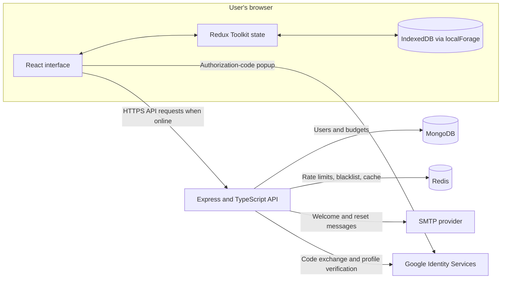

# BudgetBox: Offline-First Personal Budget Management System

**Project report**

| Submission detail          | Information                         |
| -------------------------- | ----------------------------------- |
| Student name               | [Enter student name]                |
| Registration / roll number | [Enter registration or roll number] |
| Course / subject           | [Enter course or subject]           |
| Faculty / instructor       | [Enter faculty or instructor]       |
| Institution                | [Enter institution]                 |
| Submission date            | [Enter submission date]             |

> Replace the bracketed student and course details before submission. Add your own screenshots at the marked locations.

## Abstract

BudgetBox is a personal budgeting web application designed to remain useful when a user has no internet connection. Users record monthly income and spending categories, review summaries and spending insights, and synchronize their records with a server when connectivity is available. Budget edits are persisted in the browser's IndexedDB before the interface reports them as saved. The server provides account authentication, email-based account workflows, Google sign-in, protected budget APIs, and cross-device synchronization.

The application is implemented as a React and TypeScript single-page frontend and a Node.js, Express, and TypeScript backend. MongoDB stores user and budget records, Redis supports rate limiting and response caching, and localForage provides browser-side persistence. Synchronization uses timestamps and a last-write-wins conflict policy. This report describes the project architecture, functionality, data design, security, setup, verification, limitations, and suggested screenshots.

## 1. Introduction

Many budgeting tools assume a reliable connection for routine actions. That can make it difficult to record expenses while travelling, during an outage, or in areas with poor connectivity. BudgetBox addresses this by keeping a user's working budget on their device and treating server synchronization as a background operation.

The application provides a dashboard, monthly budget entry, history, insights, account settings, and a sync center. Authenticated users can synchronize data between devices. When offline, users who have already signed in on a device can continue to work with locally saved budgets. Password accounts can also unlock their saved local data after logout by verifying their password against a locally stored salted verifier.

## 2. Problem Statement

Users need a simple way to track income and expenses without losing access when the network is unavailable. A suitable system should:

- Store edits locally before attempting network synchronization.
- Preserve data across browser reloads and temporary outages.
- Keep each user's server records and local records separate.
- Resolve concurrent edits predictably.
- Provide secure account access and account recovery.
- Present clear sync status so users know which data is local and which has reached the server.

## 3. Project Objectives

1. Build a responsive budgeting interface for monthly financial records.
2. Persist budget edits in IndexedDB and support offline viewing and editing.
3. Synchronize pending changes with an authenticated backend when online.
4. Use a documented timestamp-based conflict rule for edits from multiple devices.
5. Isolate user data in both browser storage and database queries.
6. Provide account registration, login, Google authentication, logout, password reset, and password change.
7. Add backend validation, security headers, rate limits, logging, and health checks.

## 4. Scope and Main Features

### 4.1 Budget management

Each monthly record contains income and spending totals for bills, food, transport, subscriptions, and miscellaneous expenses. The interface provides a dashboard and historical views. Calculated summaries include expense totals, savings, burn rate, month-end predictions, and rule-based anomaly notices.

### 4.2 Offline operation

Budget data is stored in user-scoped IndexedDB stores through localForage. The save flow writes to local persistence before updating the interface. The frontend marks changes as pending and queues them for synchronization. Existing local budgets remain available after a reload while offline.

After a password account signs in online on a device, BudgetBox stores a salted PBKDF2 verifier alongside its cached profile. If the user later logs out while offline, they can enter their email and password to unlock the saved budgets on that device. This local unlock does not create a server session; the user must sign in online before syncing. Google-only accounts need internet to authenticate again after logout.

### 4.3 Synchronization

The sync service collects records that are not yet synced and submits them to the backend. Server changes are then pulled using a stored per-user cursor. The sync service is single-flight, retries retryable requests with backoff, and reports conflicts to the user. Deletions are represented on the server as tombstones so they can propagate to other devices.

The interface uses three synchronization states: `local-only` for records that exist only on the device, `pending` for changes waiting to sync, and `synced` for records acknowledged by the server.

For the same user and month, the record with the newer `clientUpdatedAt` timestamp wins. The server returns its authoritative record after a sync attempt. Local data is not considered synced if it was edited again while the request was in progress.

### 4.4 Authentication and account management

The backend supports email and password registration/login, Google authorization-code login, authenticated profile retrieval, logout, password reset by email, and password changes. Passwords are hashed with bcrypt. Access tokens are JWTs; logout adds a token identifier to a Redis blacklist until its remaining expiry. Password reset tokens are stored as hashes and are single-use with a short expiration.

### 4.5 Insights and settings

Dashboard and insight calculations use the user's local records so these screens remain useful offline. Anomaly notices use deterministic threshold rules rather than AI. Settings include account, preferences, and local-data controls.

## 5. System Architecture



The frontend is a client-side application. It reads and writes local records independently of API availability. When the network is available, Axios sends authenticated requests to the API. The API validates requests, scopes queries to the authenticated user, applies rate limits, and reads or writes MongoDB and Redis as appropriate.

## 6. Technology Stack

| Area                    | Technology                            | Purpose                                            |
| ----------------------- | ------------------------------------- | -------------------------------------------------- |
| Frontend                | React 18, TypeScript, Vite            | Single-page application and typed UI               |
| UI and routing          | Tailwind CSS, React Router, Lucide    | Styling, navigation, and icons                     |
| Client state            | Redux Toolkit, React Redux            | Authentication, budgets, settings, and sync state  |
| Local persistence       | localForage, IndexedDB                | Offline budget and cached profile storage          |
| Forms and validation    | React Hook Form, Zod                  | Form handling and client/server input validation   |
| Charts and utilities    | Recharts, date-fns                    | Data visualizations and date calculations          |
| HTTP client             | Axios                                 | API requests and shared interceptors               |
| Backend                 | Node.js 20, Express, TypeScript       | REST API and application services                  |
| Database                | MongoDB, Mongoose                     | User and budget document persistence               |
| Cache and rate limits   | Redis, ioredis, rate-limiter-flexible | Cache, token blacklist, and request controls       |
| Security and operations | Helmet, CORS, bcrypt, JWT, Pino       | HTTP security, authentication, and structured logs |
| Email                   | Nodemailer                            | Welcome and password-reset messages                |
| Local infrastructure    | Docker Compose                        | Local MongoDB and Redis services                   |
| CI                      | GitHub Actions                        | Frontend/backend install, build, and test jobs     |

## 7. Data Design

### 7.1 User

The `User` document stores a display name, unique normalized email, optional password hash, optional Google account identifier, password-change timestamp, and creation/update timestamps. The password hash is excluded from ordinary query results. Google-only users can have no local password hash.

### 7.2 Budget

The `Budget` document stores a user reference, month and year, income and expense category amounts, client and server update timestamps, a version number, deletion state, and optional client record identifier. Amounts are non-negative and bounded. A unique compound index on `{ userId, month, year }` prevents duplicate monthly records for one user. A second index on `{ userId, serverUpdatedAt }` supports efficient delta pulls.

Every budget query is scoped by the authenticated user's ID. This prevents one account from retrieving another account's records through the API.

### 7.3 Browser storage

LocalForage creates separate stores for budget records, sync metadata, cached account information, and offline password verifiers. Budget and sync stores are namespaced by user ID. Logging out clears the active session but leaves saved budgets intact; the explicit clear-local-data action removes a user's local budget and sync data and offline verifier.

## 8. API Overview

All API routes use the `/api` prefix. Successful responses use `{ success: true, data }`; failures use `{ success: false, error }`.

| Method | Endpoint                    | Purpose                                    | Authentication |
| ------ | --------------------------- | ------------------------------------------ | -------------- |
| GET    | `/api/health`               | Reports MongoDB and Redis availability     | No             |
| POST   | `/api/auth/register`        | Creates a password account                 | No             |
| POST   | `/api/auth/login`           | Starts an email/password session           | No             |
| POST   | `/api/auth/google`          | Exchanges a Google authorization code      | No             |
| GET    | `/api/auth/me`              | Returns the current account profile        | Yes            |
| POST   | `/api/auth/logout`          | Revokes the current JWT until expiry       | Yes            |
| POST   | `/api/auth/forgot-password` | Requests a password-reset email            | No             |
| POST   | `/api/auth/reset-password`  | Applies a single-use reset token           | No             |
| POST   | `/api/auth/change-password` | Changes the authenticated account password | Yes            |
| POST   | `/api/budget/sync`          | Uploads pending budget records             | Yes            |
| GET    | `/api/budget/latest`        | Returns the latest non-deleted budget      | Yes            |
| GET    | `/api/budget/history`       | Returns budget history, optionally by year | Yes            |
| GET    | `/api/budget/changes`       | Returns server changes after a timestamp   | Yes            |

Latest and history reads use a Redis cache with a 60-second TTL and expose an `X-Cache` header. Cache failure falls back to MongoDB. Budget writes invalidate the affected cached views.

## 9. Security and Reliability

- Passwords are hashed with bcrypt; passwords are never stored in plaintext.
- Password and budget request bodies are validated with Zod.
- JWTs are signed with HS256 and include a unique token identifier.
- Logout blacklists the token identifier in Redis until token expiry.
- Password reset tokens are random, hashed before storage, single-use, and time-limited.
- Google sign-in verifies the authorization code on the backend and requires a verified email.
- Helmet adds standard HTTP security headers; CORS is restricted to the configured frontend origin.
- JSON request bodies are limited to 100 KB.
- Redis-backed rate limits cover global API traffic, registration, login failures, password reset, and budget synchronization. An in-memory insurance limiter provides a fallback if Redis is unavailable.
- Pino and Pino HTTP provide structured application and request logs. Sensitive authorization headers are redacted by the logger configuration.
- MongoDB and Redis connection state is exposed by the health endpoint. The server handles shutdown signals and closes connections gracefully.

## 10. Running the Project Locally

1. Install Node.js 20 or newer and Docker Desktop.
2. Copy `backend/.env.example` to `backend/.env` and configure local database URLs, a JWT secret, and any optional SMTP or Google OAuth values.
3. Copy `frontend/.env.example` to `frontend/.env`. Set `VITE_API_URL` and `VITE_GOOGLE_CLIENT_ID` as needed. Do not put a Google client secret in a frontend environment variable.
4. From the repository root, start local data services:

   ```powershell
   docker compose up -d
   ```

5. In one terminal, install and run the backend:

   ```powershell
   cd backend
   npm install
   npm run dev
   ```

6. In a second terminal, install and run the frontend:

   ```powershell
   cd frontend
   npm install
   npm run dev
   ```

7. Open the Vite URL, normally `http://localhost:5173`. The API health endpoint is `http://localhost:5000/api/health`.

Google sign-in additionally requires a Google OAuth Web application client. Configure the frontend origin as an authorized JavaScript origin. Keep the corresponding client secret on the backend only.

## 11. Verification and Testing

The repository includes frontend unit tests for calculation helpers, anomaly rules, and sync merge decisions. Backend tests cover API and authentication behavior, including Google code flow, and use Vitest, Supertest, MongoDB Memory Server, and Redis mocks where applicable. A GitHub Actions workflow defines install, build, and test jobs for both applications.

At report preparation, the frontend production build and backend TypeScript build completed successfully. The focused Google authentication test file passed (2 tests). The entire backend test suite has not been confirmed in this report pass; full integration testing should be completed before describing the project as fully validated.

## 12. Screenshots to Add

Replace each placeholder with a screenshot captured from the running application. Avoid including real personal or financial data in submitted screenshots.

> **Screenshot 1 — Login page:** Add a screenshot of the BudgetBox login screen, including the email/password form and Google sign-in button.

> **Screenshot 2 — Dashboard:** Add a screenshot of the dashboard showing the monthly summary and budget overview.

> **Screenshot 3 — Budget form:** Add a screenshot of the monthly income and expense entry form.

> **Screenshot 4 — History and insights:** Add a screenshot of the budget history or insights view, showing a chart or rule-based notice.

> **Screenshot 5 — Offline behavior:** Add a screenshot of the app with the offline indicator visible and locally saved budget data displayed.

> **Screenshot 6 — Sync center:** Add a screenshot of the Sync page showing pending/synced states or the conflict notification.

> **Screenshot 7 — Account settings:** Add a screenshot of the settings page with account and local-data controls.

## 13. Current Limitations and Future Work

- Google-only users need an internet connection to authenticate after logging out; local password verification is available only to password accounts.
- Offline edits are device-local until the user reconnects and signs in online to sync.
- The complete backend integration test suite and multi-device conflict scenario still need a final end-to-end run.
- The seed command is currently a scaffold and does not yet populate the demo account and sample months.
- Docker Compose provides MongoDB and Redis for local development. The frontend now has Vercel deployment configuration, but the backend production Dockerfile/deployment and an actual production deployment are still outstanding.
- Production deployment still requires hosted MongoDB and Redis, HTTPS, SMTP credentials, a frontend origin, OAuth configuration, and secure environment-variable management.

Possible future improvements include completing the seed script, adding browser-level offline and multi-device tests, deploying the frontend and API to a production environment, and adding optional device-specific authentication for offline unlock of Google-only accounts.

## 14. Conclusion

BudgetBox combines local-first budgeting with an authenticated backend for account management and cross-device synchronization. Its local persistence lets users keep working when connectivity is unavailable, while the timestamp-based merge process helps reconcile edits after reconnection. The project also includes account recovery, Google authentication, backend input validation, per-user data isolation, rate limiting, and operational logging.

The frontend and backend builds pass, and the focused Google authentication tests pass. Completing the full integration verification and the remaining seed/deployment work would strengthen the project for production use. The architecture provides a practical foundation for a personal budgeting application that remains useful offline while supporting synchronized access across devices.
